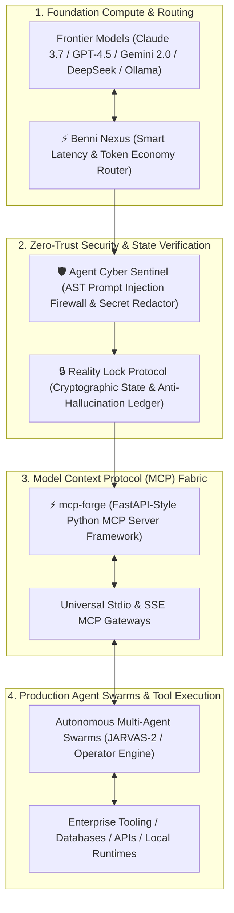

<div align="center">

# ⚡ BENNI ALENCAR
### Chief AI Systems Architect & Founder @ [Benni OS](https://benni-os.net)

<p align="center">
  <b>Pioneering Model Context Protocol (MCP) Infrastructure • Autonomous Multi-Agent Systems • Zero-Trust Agent Security</b>
</p>

[](https://benni-os.net)
[](https://www.linkedin.com/in/benni-alencar/)
[](https://github.com/BenniAlencar)
[](https://modelcontextprotocol.io)
[](https://github.com/BenniAlencar/agent-cyber-sentinel)

---

</div>

## 🌐 Engineering Creed & Architecture Vision

> *"A IA estocástica só se torna útil para a engenharia quando governada por protocolos determinísticos, auditoria criptográfica e isolamento de privilégio mínimo."*

Eu projeto e construo a infraestrutura soberana necessária para que **agentes autônomos de IA**, **gateways MCP** e **sistemas distribuídos** operem em ambientes corporativos de missão crítica sem alucinações, sem vazamento de segredos e com rastreabilidade total.

Criador do ecossistema **Benni Master OS v9.4**, um arcabouço unificado de governança, memória persistente, roteamento de inferência e orquestração de enxames de agentes com mais de 20 subsistemas integrados.

---

## 🏛️ System Topology: Benni Master OS Stack

Abaixo está a topologia arquitetural que governa a comunicação entre modelos de fronteira, runtimes MCP e camadas de execução autônoma:



---

## 🚀 Flagship Open Source Projects

### 1. [`mcp-forge`](https://github.com/BenniAlencar/mcp-forge)
> **The FastAPI-style Python framework for high-throughput Model Context Protocol (MCP) servers.**

* **Zero-Boilerplate Server Definition**: Crie servidores MCP completos com decorators intuitivos, tipagem Pydantic nativa e injeção automática de contexto.
* **Auto-Negotiation**: Suporte transparente a transporte bidirecional `stdio` e `SSE` (Server-Sent Events).
* **Sub-Millisecond Routing**: Despacho de ferramentas otimizado com validação de payload em tempo de compilação.
* **SDK Compatibility**: 100% interoperável com Claude Desktop, Cursor, Windsurf, Antigravity e harnesses empresariais.

```python
from mcp_forge import FastMCP

app = FastMCP(name="EnterpriseDataGateway", version="1.0.0")

@app.tool()
async def query_secure_ledger(tenant_id: str, query: str) -> dict:
    """Consulta dados corporativos isolados por tenant com verificação de integridade."""
    return await database.fetch(tenant_id, query)

if __name__ == "__main__":
    app.run(transport="stdio")
```

---

### 2. [`agent-cyber-sentinel`](https://github.com/BenniAlencar/agent-cyber-sentinel)
> **Tier-0 Zero-Trust runtime security shield, prompt injection firewall & secret redactor para agentes de IA.**

* **Defense in Depth (POD-9)**: 9 camadas de defesa cobrindo desde sanitização de prompt até sandbox de ferramentas.
* **Anti-Prompt-Injection Engine**: Detecção semântica e baseada em AST de injeções diretas e indiretas (jailbreaks, indirect payload delivery).
* **Automatic Secret Redaction**: Ofuscação de chaves de API, credenciais AWS/GCP, tokens JWT e PII antes do envio a qualquer LLM externo.
* **Blast Radius Limiter**: Restrições estritas de syscall e isolamento de ambiente para agentes com permissão de execução de código.

---

### 3. [`reality-lock`](https://github.com/BenniAlencar/reality-lock)
> **Deterministic state preservation & anti-hallucination ledger protocol for agentic workflows.**

* **Reconciliação Tríplice**: Separação estrita entre *Intenção*, *Plano*, *Despacho* e *Evidência Observada*.
* **Hash Audit Trail**: Checkpoints atômicos criptográficos que garantem rollback imediato se um agente divergir do objetivo.
* **Formal Verification**: Garante que uma tarefa só seja dada como concluída mediante teste ou evidência verificada por probe independente.

---

### 4. [`benni-nexus`](https://github.com/BenniAlencar/benni-nexus)
> **Unified LLM Gateway com roteamento semântico, failover resiliente e economia de tokens.**

* **Hybrid AI Topology**: Roteamento dinâmico entre modelos de fronteira na nuvem e modelos locais (Ollama / vLLM / llama.cpp).
* **Cost & Token Economics**: Auditoria de custo por token, compressão de contexto e fallbacks automáticos em caso de rate limit ou timeout.

---

## 🗄️ O Ecossistema Benni OS em Números

| Camada | Repositórios / Módulos Chave | Status | Propósito |
| :--- | :--- | :--- | :--- |
| **MCP Infrastructure** | `mcp-forge`, `benni-content-engine`, `operator-gateway` | 🟢 Ativo / Produção | Conexão de ferramentas e protocolos abertos |
| **Security & Safety** | `agent-cyber-sentinel`, `reality-lock` | 🟢 Tier-0 Hardened | Blindagem contra jailbreaks e alucinações |
| **Inference & Routing** | `benni-nexus`, `token-economy-bridge` | 🟢 Ativo | Otimização de latência, custo e privacidade |
| **Agent Swarm OS** | `Benni Master OS v9.4`, `JARVAS-2`, `Control Plane` | 🟢 Ativo | Runtimes de agentes determinísticos e orquestração |
| **Education & B2B** | `Modo Operador`, `autonomous-funnel-system` | 🟢 Em Escala | Capacitação e automação aplicada para empresas |

---

## 🛠️ Tech Stack & Engineering Core

<div align="left">

* **Linguagens**: Python 3.11+, TypeScript, Go, Rust, Bash, SQL
* **AI & Agent Frameworks**: Model Context Protocol (MCP), LangGraph, Custom Deterministic Runtimes, PydanticAI
* **Backend & Systems**: FastAPI, AsyncIO, Docker, Linux Kernel Namespaces, PostgreSQL, Redis, Cloudflare Workers
* **Security & Observability**: OpenTelemetry, Zero-Trust Architecture, AST Parsers, Cryptographic Hashing, Vault

</div>

---

## 📬 Conecte-se & Colaboração

* 🌍 **Website & Blog Técnico:** [benni-os.net](https://benni-os.net)
* 💼 **LinkedIn Profissional:** [linkedin.com/in/benni-alencar](https://www.linkedin.com/in/benni-alencar/)
* 🐙 **GitHub Oficial:** [@BenniAlencar](https://github.com/BenniAlencar)
* 📧 **Contato Executivo / Parcerias:** contato através de [benni-os.net](https://benni-os.net) ou LinkedIn

<div align="center">
  <sub>Benni Alencar • Benni OS • Sovereign AI Infrastructure • Built with Determinism.</sub>
</div>
